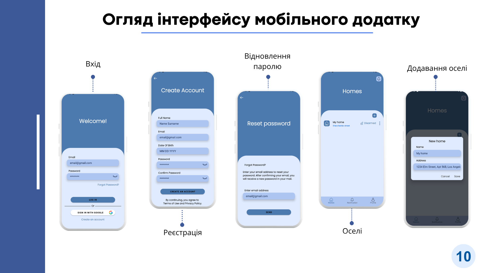

# Smart Home — Secure Mobile App with Face Recognition

A mobile application for securely managing smart home features, with important actions confirmed through facial recognition.

## Main Features

- User authentication
- Management of homes, sensors, and security modes
- Event notifications
- Biometric authentication based on facial recognition:
  - Face registration (multiple head positions)
  - Biometric template generation
  - Identity verification before performing protected operations
  - Short-lived verification session (3 minutes)
  - Encrypted local storage of the biometric template

## Technologies

- Kotlin
- MVVM
- Retrofit
- CameraX
- ML Kit
- LiteRT (FaceNet)
- Hilt
- Room
- Firebase
- EncryptedSharedPreferences

## Screenshots

## Author

Vladyslav Bilous  
Kharkiv National University of Radio Electronics  
Specialty 121 — Software Engineering
